# Part 1: Basic 5T OTA Sizing in SKY130 using Open-LUT

> A step-by-step guide to tool-assisted transistor sizing for a basic 5-transistor Operational Transconductance Amplifier (OTA) in SkyWater 130nm PDK (SKY130) using the [Open-LUT](https://open-lut.app) web application.

> [!NOTE]
> **Scope & Focus:** This guide demonstrates how to navigate and leverage Open-LUT to streamline transistor sizing for basic gain and bandwidth targets. While core $g_m/I_D$ equations are included, primary focus is placed on tool execution and simulation verification in Ngspice and Xschem.

---

## 1. Circuit Topology & Specifications

This guide presents a step-by-step procedure for designing a single-ended NMOS differential pair 5-transistor (5T) Operational Transconductance Amplifier (OTA) using SkyWater's open-source 130nm PDK (SKY130) facilitated by Open-LUT. The target schematic is shown in **Figure 1**, and the design requirements are summarized in **Table 1**.

  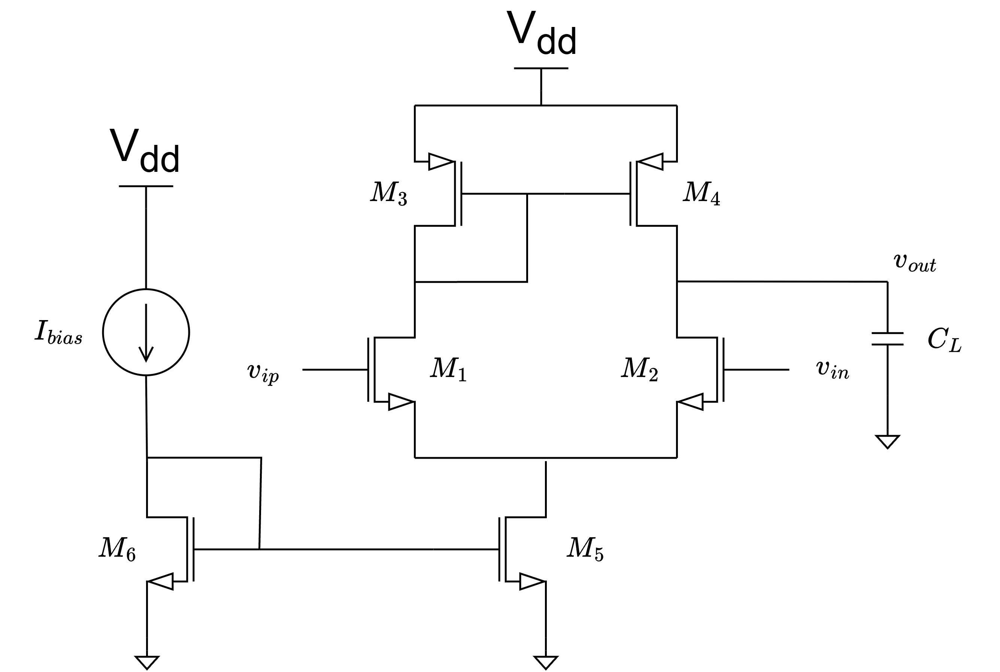
   

  Figure 1. 5-transistor (5T) Operational Transconductance Amplifier (OTA) with NMOS input pair.

### Table 1: Design Specifications

| Specification Parameter | Symbol | Target Value |
| :--- | :---: | :---: |
| **PDK Technology** | - | SkyWater 130nm (SKY130) |
| **Supply Voltage** | $V_{DD}$ | $1.8\\text{ V}$ |
| **Reference Current** | $I_{bias}$ | $10\\,\mu\\text{A}$ |
| **Tail Current** | $I_{SS}$ | $20\\,\mu\\text{A}$ |
| **Capacitive Load** | $C_L$ | $5\\text{ pF}$ |
| **Open-Loop DC Gain** | $A_{V,DC}$ | $\\ge 32\\text{ dB}\\ (39.81\\text{ V/V})$ |
| **Gain-Bandwidth Product** | $GBW$ | $\\ge 5\\text{ MHz}$ |

---

## 2. $V_{DS}$ Bias Allocation

Open-LUT queries $g_m/I_D$ lookup tables at specific drain-to-source bias voltages ($V_{DS}$). To ensure accurate lookup results, an initial $V_{DS}$ budget is allocated across the transistor stack:

* **Tail NMOS ($M_5$):** Allocated $V_{DS5} = 0.3\\text{ V}$ to maintain saturation (assuming $V_{ov5} \\approx 100\\text{--}200\\text{ mV}$) while maximizing voltage headroom for $M_1/M_2$ and $M_3/M_4$.
* **Input Pair ($M_1/M_2$) & Load Mirror ($M_3/M_4$):** The remaining $1.5\\text{ V}$ headroom is split equally, allocating $V_{DS1,2} = 0.75\\text{ V}$ and $V_{DS3,4} = 0.75\\text{ V}$.

  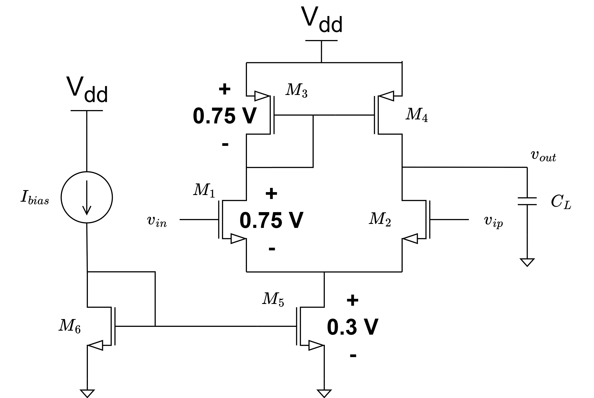
    

  Figure 2. Initial $V_{DS}$ Bias Allocation across the 5T OTA Transistor Stack.

---

## 3. Sizing the Input Differential Pair ($M_1/M_2$)

From the Gain-Bandwidth ($GBW$) and load capacitance ($C_L$) specifications, the required transconductance $g_{m1,2}$ is determined:

$$GBW = \\frac{g_{m1,2}}{2\\pi C_L} \\implies g_{m1,2} = 2\\pi \\cdot GBW \\cdot C_L$$

For $GBW = 5\\text{ MHz}$ and $C_L = 5\\text{ pF}$, $g_{m1,2} = 0.157\\text{ mS} \\approx 0.16\\text{ mS}$. With a branch current $I_{D1,2} = I_{SS}/2 = 10\\,\mu\\text{A}$, the transconductance efficiency is:

$$\\left(\\frac{g_m}{I_D}\\right)_{1,2} \\ge \\frac{0.16\\text{ mS}}{10\\,\mu\\text{A}} = 16\\text{ S/A}$$

The DC gain requirement dictates the output conductance constraint:

$$\vert{}A_{V,DC}\vert{} = \\frac{g_{m1,2}}{g_{ds1,2} + g_{ds3,4}} \\ge 39.81 \\implies g_{ds1,2} + g_{ds3,4} \\le 4\\,\\mu\\text{S}$$

Assuming equal conductance distribution ($g_{ds1,2} = g_{ds3,4}$), both $g_{ds1,2}$ and $g_{ds3,4}$ must be $\\le 2\\,\\mu\\text{S}$. Adding design margin, target parameters are set to $g_{m1,2} = 0.17\\text{ mS}$ and $g_{ds1,2} = 1.5\\,\\mu\\text{S}$.

> [!IMPORTANT]
> **CRITICAL OPEN-LUT WORKFLOW RULE:** Select your device and $V_{DS}$ bias, then click **`Update`** once to load the lookup tables for that setup. After this initial update, **always click the `Clear Form / Reset Plots` button before entering every new set of values!** Open-LUT preserves previous input fields and solution curves until explicitly reset. Entering new numbers into an uncleared form can lead to parameter conflicts or invalid extractions.

In Open-LUT, select device `sky130_nfet_01v8` and $V_{ds} = 0.75\\text{ V}$, then click **Update**. Entering $g_m = 0.17\\text{ mS}$, $I_D = 0.01\\text{ mA}$, and $g_{ds} = 0.0015\\text{ mS}$ dynamically yields $L = 0.4204\\,\\mu\\text{m}$ and $W = 4.7286\\,\\mu\\text{m}$.

  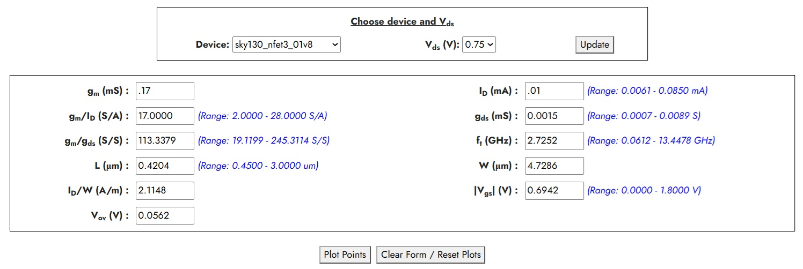
   

 Figure 3. Open-LUT Interface for Input Pair $M_1/M_2$ Sizing.

To snap the channel length to the SKY130 layout grid ($0.005\\,\\mu\\text{m}$ grid step), clear the form first by clicking **`Clear Form / Reset Plots`**, then enter $I_D = 0.01\\text{ mA}$, $g_m = 0.17\\text{ mS}$, and $L = 0.4205\\,\\mu\\text{m}$ as the third parameter instead of $g_{ds}$. If needed, iterate input values slightly within the valid blue dynamic range bounds indicated by Open-LUT until all parameters align with design specs.

### Table 2: Sizing and Biasing for $M_1/M_2$

| Parameter | $(g_m/I_D)_{1,2}$ | $L_{1,2}$ | $W_{1,2}$ | $g_{m1,2}$ | $g_{ds1,2}$ | $V_{ov1,2}$ | $V_{GS1,2}$ |
| :--- | :---: | :---: | :---: | :---: | :---: | :---: | :---: |
| **Value** | $17\\text{ S/A}$ | $0.4205\\,\\mu\\text{m}$ | $4.7300\\,\\mu\\text{m}$ | $0.17\\text{ mS}$ | $1.5\\,\\mu\\text{S}$ | $0.0562\\text{ V}$ | $0.6942\\text{ V}$ |

---

## 4. Sizing the Current Mirror Loads ($M_3/M_4$)

As established in Section 3, $M_3$ and $M_4$ are sized such that $g_{ds3,4} < 2\,\mu\text{S}$. Furthermore, since $M_3$ is diode-connected, its gate-to-source voltage $V_{GS3}$ is constrained to follow $V_{DS3}$.

To prevent simulation inaccuracies caused by the non-physical $g_m/I_D$ hump exhibited by standard SKY130 PMOS devices (`pfet_01v8`, **Figure 4**), the low-threshold PMOS device `sky130_pfet_01v8_lvt` is selected. In Open-LUT, select `sky130_pfet_01v8_lvt` with the allocated $V_{ds} = 0.75\text{ V}$, then click **Update** to extract the corresponding lookup tables.

  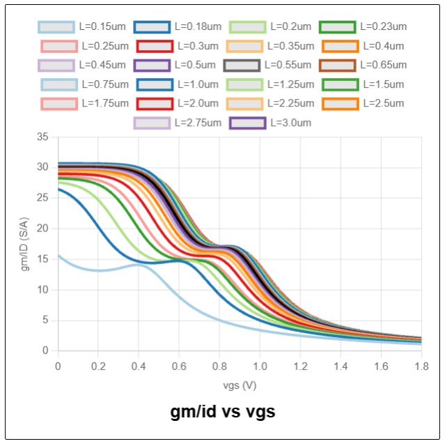
   

 Figure 4. Non-physical $g_m/I_D$ hump in standard SKY130 PMOS (`pfet_01v8`).

From the $V_{GS}$ vs. $g_m/I_D$ plot (**Figure 5**), achieving the target biasing $V_{GS3,4} = V_{DS3,4} = 0.75\text{ V}$ restricts $g_m/I_D$ to the range of $4\text{--}5.5\text{ S/A}$.

  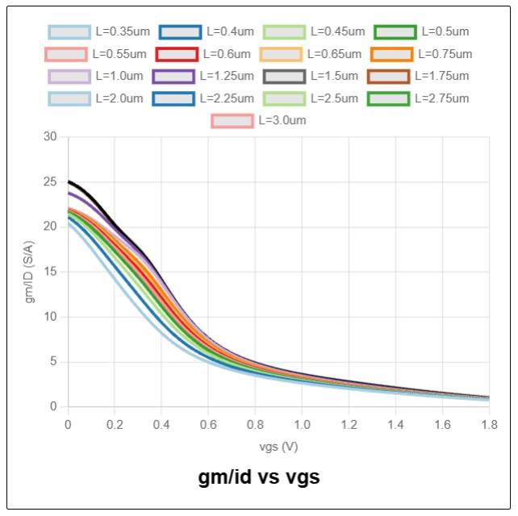
   

 Figure 5. $g_m/I_D$ vs $V_{GS}$ characteristic for LVT PMOS (`pfet_01v8_lvt`).

Entering a branch current $I_D = 0.01\text{ mA}\ (10\,\mu\text{A})$ and an initial $g_m/I_D = 4\text{ S/A}$ dynamically updates the achievable range bounds for $g_{ds}$ (shown in blue text in **Figure 6**). This confirms that the required $g_{ds} < 2\,\mu\text{S}$ is indeed attainable within this $g_m/I_D$ operating range.

  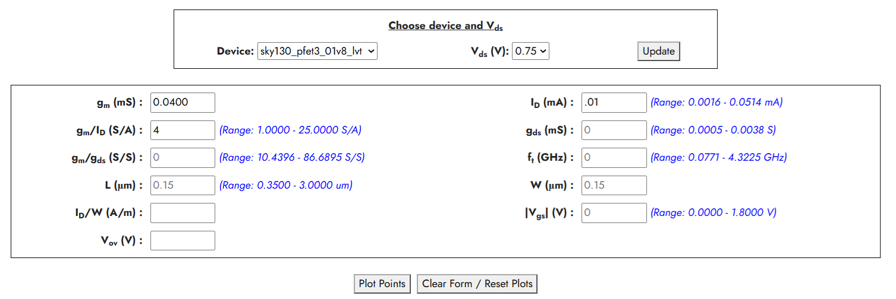
   

 Figure 6. Open-LUT range bounds for $M_3/M_4$ at $I_D = 10\,\mu\text{A}$ and $g_m/I_D = 4\text{ S/A}$.

An initial entry of $I_D = 0.01\text{ mA}$, $g_m/I_D = 4\text{ S/A}$, and $g_{ds} = 0.0015\text{ mS}\ (1.5\,\mu\text{S})$ into Open-LUT converges the device aspect ratio $W/L$ to $1.1505\,\mu\text{m} / 0.8020\,\mu\text{m}$ and yields $V_{GS} = 0.8805\text{ V}$. However, because $V_{GS} = 0.8805\text{ V}$ deviates from the allocated $V_{DS3,4} = 0.75\text{ V}$, this preliminary sizing is not achievable for the target $V_{DS3,4}$ bias allocation.

To resolve this bias discrepancy, click **`Clear Form / Reset Plots`** and repeat the process for different values of $g_m/I_D$ across the $4\text{--}5.5\text{ S/A}$ range. A $V_{GS}$ of $0.7499\text{ V}$ (matching the $0.75\text{ V}$ target) is successfully attained at $g_m/I_D = 5.03\text{ S/A}$ with an aspect ratio of $W/L = 1.9276\,\mu\text{m} / 0.7493\,\mu\text{m}$.

Clearing the form once more and entering $I_D = 0.01\text{ mA}$, $g_m/I_D = 5.03\text{ S/A}$, and the layout-grid-snapped channel length $L = 0.7495\,\mu\text{m}$ extracts the finalized dimensions and operating point for $M_3/M_4$ summarized in **Table 3**.### Table 3: Sizing and Biasing for $M_3/M_4$

| Parameter | $(g_m/I_D)_{3,4}$ | $L_{3,4}$ | $W_{3,4}$ | $g_{m3,4}$ | $g_{ds3,4}$ | $V_{ov3,4}$ | $V_{GS3,4}$ |
| :--- | :---: | :---: | :---: | :---: | :---: | :---: | :---: |
| **Value** | $5.03\\text{ S/A}$ | $0.7495\\,\\mu\\text{m}$ | $1.9280\\,\\mu\\text{m}$ | $0.0503\\text{ mS}$ | $1.5\\,\\mu\\text{S}$ | $0.4172\\text{ V}$ | $0.7500\\text{ V}$ |

---

## 5. Sizing Tail Current Source ($M_5$) & Bias Mirror ($M_6$)

The tail transistor $M_5$ must carry $I_{SS} = 20\\,\\mu\\text{A}$ with $V_{DS5} = 0.3\\text{ V}$ while staying in saturation ($V_{ov5} \\le 0.2\\text{ V}$). Operating in moderate inversion ($g_m/I_D \\approx 13\\text{--}16\\text{ S/A}$) with $L_5 \\ge 1\\,\\mu\\text{m}$ ensures low overdrive voltage and minimizes channel length modulation.

  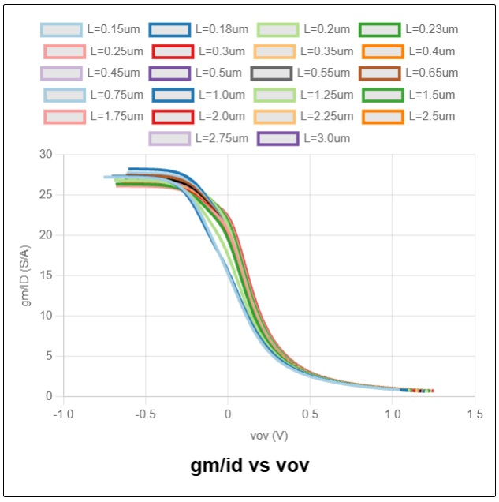
   

 Figure 7. $g_m/I_D$ vs $V_{ov}$ characteristic for `sky130_nfet_01v8`.

Clear the form using **`Clear Form / Reset Plots`**, select `sky130_nfet_01v8` at $V_{ds} = 0.3\\text{ V}$, and click **Update**. Enter $I_D = 0.02\\text{ mA}$ and $L = 1\\,\\mu\\text{m}$. Iterate the inputting of $g_m/I_D$ values within the $13.5\\text{--}16\\text{ S/A}$ range until a suitable overdrive voltage $V_{ov5} \\approx 100\\text{ mV}$ is attained. At $g_m/I_D = 13.7\\text{ S/A}$, Open-LUT extracts $V_{ov5} = 0.1006\\text{ V}$ and the finalized dimensions in **Table 4**.

### Table 4: Sizing and Biasing for $M_5$

| Parameter | $(g_m/I_D)_5$ | $L_5$ | $W_5$ | $g_{m5}$ | $g_{ds5}$ | $V_{ov5}$ | $V_{GS5}$ |
| :--- | :---: | :---: | :---: | :---: | :---: | :---: | :---: |
| **Value** | $13.7\\text{ S/A}$ | $1.0000\\,\\mu\\text{m}$ | $10.5435\\,\\mu\\text{m}$ | $0.2740\\text{ mS}$ | $4.9\\,\\mu\\text{S}$ | $0.1006\\text{ V}$ | $0.7041\\text{ V}$ |

Bias mirror $M_6$ carries $I_{bias} = 10\\,\\mu\\text{A}$ (half of $I_{SS}$) and is scaled to $(W/L)_6 = 5.2720 / 1.0000\\,\\mu\\text{m}$.

---

## 6. Verification in Xschem & Ngspice

The design was verified using Xschem and Ngspice within the IIC-OSIC-TOOLS Docker environment. The simulation setup is shown in **Figure 8**, and schematic files are available in the `./cir/` subfolder.

  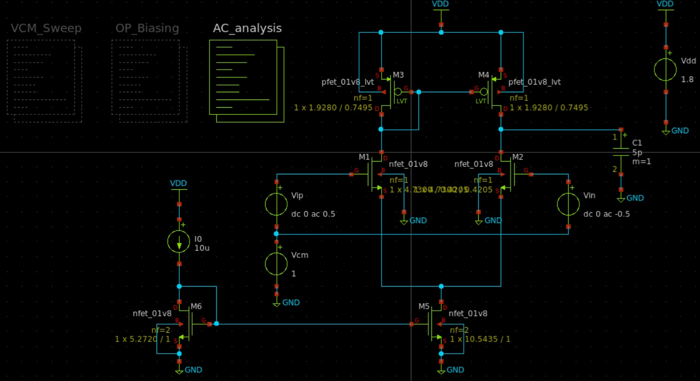
   

 Figure 8. Xschem simulation setup for 5T OTA verification.

A DC common-mode sweep ($V_{CM}$ from $0$ to $1.8\\text{ V}$) identifies the valid operating range (**Figures 9 & 10**). Selecting $V_{CM} = 1.0\\text{ V}$ establishes an optimal operating point.

<table style="border-collapse: collapse; border: none; width: 100%;">
  <tr style="text-align: center;">
    <td style="padding: 0; width: 50%; text-align: center; vertical-align: middle;">
      

        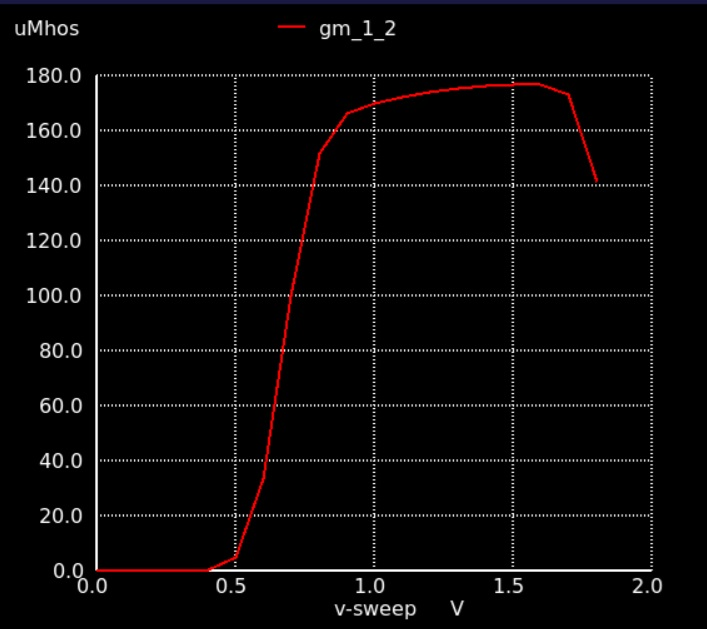
         
      

      

       Figure 9. Transconductance $g_{m1,2}$ vs Input Common-Mode Voltage $V_{CM}$.
      

    </td>
    <td style="padding: 0; width: 50%; text-align: center; vertical-align: middle;">
      

        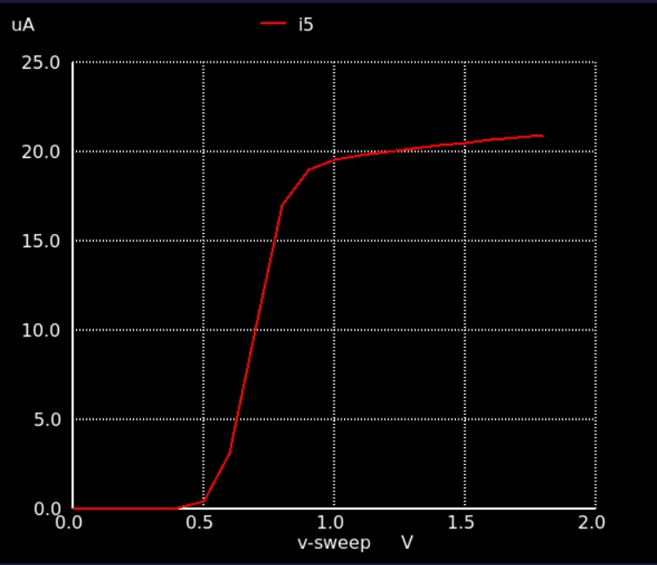
         
      

      

       Figure 10. Tail current $I_{SS}$ vs Input Common-Mode Voltage $V_{CM}$.
      

    </td>
  </tr>
</table>

**Table 5** compares the Open-LUT computed values against Ngspice DC operating point simulation results at $V_{CM} = 1.0\\text{ V}$.

### Table 5: Open-LUT vs. Simulated Operating Point ($V_{CM} = 1.0\\text{ V}$)

| Operating Parameter | Open-LUT Value | Simulated Value (Ngspice) |
| :--- | :---: | :---: |
| $g_{m1,2}$ | $0.1700\\text{ mS}$ | $0.1702\\text{ mS}$ |
| $g_{ds1,2}$ | $1.5000\\,\\mu\\text{S}$ | $1.6500\\,\\mu\\text{S}$ |
| $V_{ov1,2}$ | $0.0562\\text{ V}$ | $0.0870\\text{ V}$ |
| $V_{GS1,2}$ | $0.6942\\text{ V}$ | $0.7373\\text{ V}$ |
| $V_{DS1,2}$ | $0.7500\\text{ V}$ | $0.7444\\text{ V}$ |
| $I_{D1,2}$ | $10.000\\,\\mu\\text{A}$ | $9.768\\,\\mu\\text{A}$ |
| $g_{m3,4}$ | $0.0503\\text{ mS}$ | $0.0521\\text{ mS}$ |
| $g_{ds3,4}$ | $1.5000\\,\\mu\\text{S}$ | $1.4265\\,\\mu\\text{S}$ |
| $V_{ov3,4}$ | $0.4172\\text{ V}$ | $0.3354\\text{ V}$ |
| $V_{GS3,4}$ | $0.7500\\text{ V}$ | $0.7930\\text{ V}$ |
| $V_{DS3,4}$ | $0.7500\\text{ V}$ | $0.7930\\text{ V}$ |
| $I_{D3,4}$ | $10.000\\,\\mu\\text{A}$ | $9.768\\,\\mu\\text{A}$ |
| $g_{m5}$ | $0.2740\\text{ mS}$ | $0.2735\\text{ mS}$ |
| $g_{ds5}$ | $4.9000\\,\\mu\\text{S}$ | $4.1424\\,\\mu\\text{S}$ |
| $V_{ov5}$ | $0.1006\\text{ V}$ | $0.1186\\text{ V}$ |
| $V_{GS5}$ | $0.7041\\text{ V}$ | $0.6988\\text{ V}$ |
| $V_{DS5}$ | $0.3000\\text{ V}$ | $0.2627\\text{ V}$ |
| $I_{D5}$ | $20.000\\,\\mu\\text{A}$ | $19.535\\,\\mu\\text{A}$ |

An AC sweep (`.ac`) verifies open-loop gain and bandwidth (**Figure 11**). **Table 6** confirms that all specifications are satisfied in a single pass.

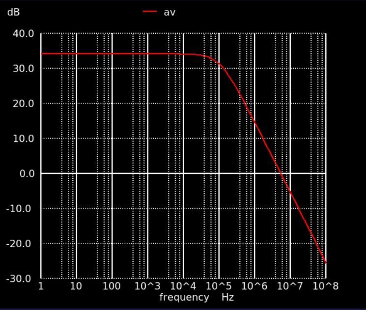
*Figure 11. AC magnitude response of the designed 5T OTA.*

### Table 6: Simulation Results vs. Specifications

| Specification Parameter | Target Requirement | Simulated Performance |
| :--- | :---: | :---: |
| **Open-Loop DC Gain ($A_{V,DC}$)** | $\\ge 32.00\\text{ dB}$ | $34.73\\text{ dB}$ |
| **Gain-Bandwidth Product ($GBW$)** | $\\ge 5.00\\text{ MHz}$ | $5.27\\text{ MHz}$ |
| **Tail Current ($I_{SS}$)** | $\\le 20.00\\,\\mu\\text{A}$ | $19.535\\,\\mu\\text{A}$ |

---

## 7. Conclusion

Open-LUT enables single-pass transistor sizing, eliminating time-consuming simulation-in-the-loop iterations. By linking specifications directly to $g_m/I_D$ tables, design convergence is achieved efficiently. Complete schematic files are provided in the `./cir/` subfolder.

