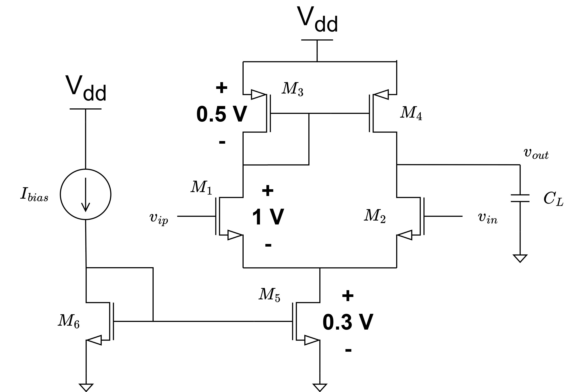
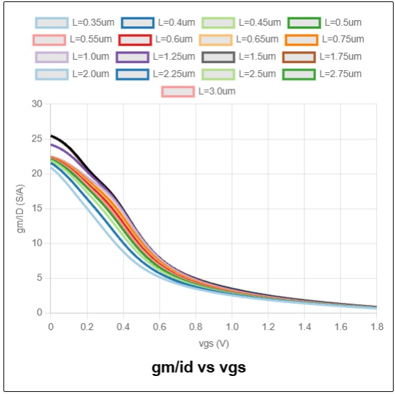
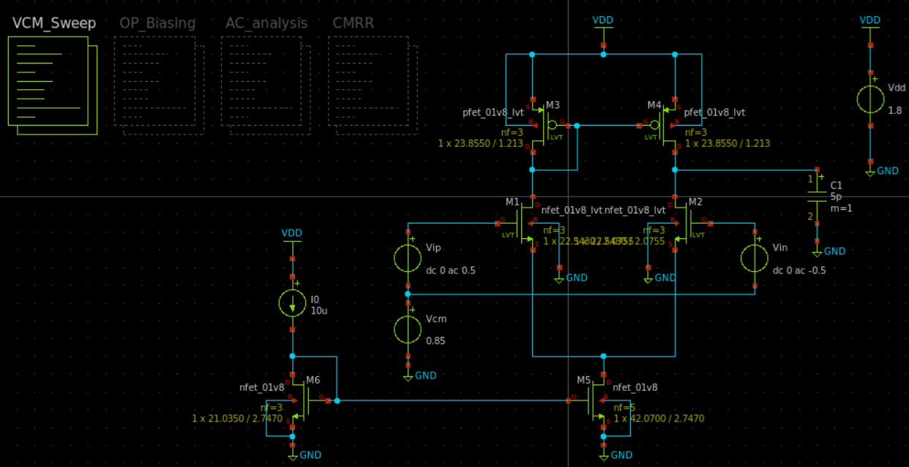
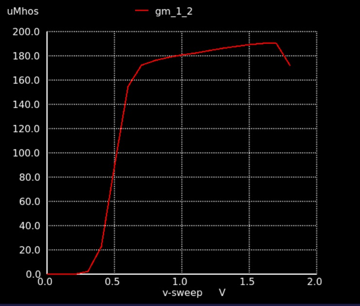
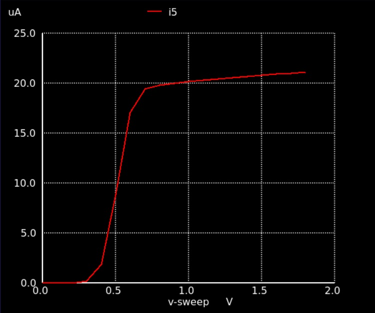
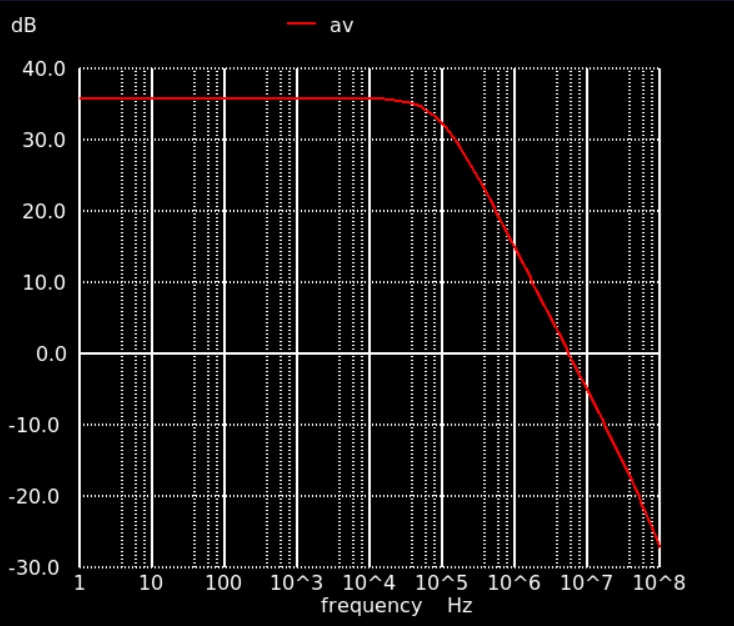
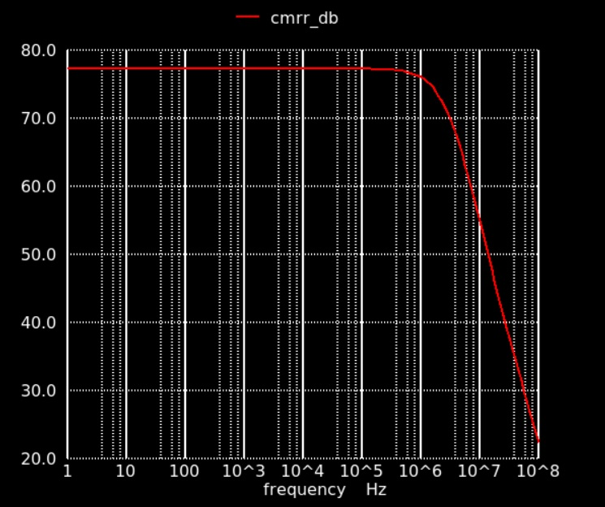
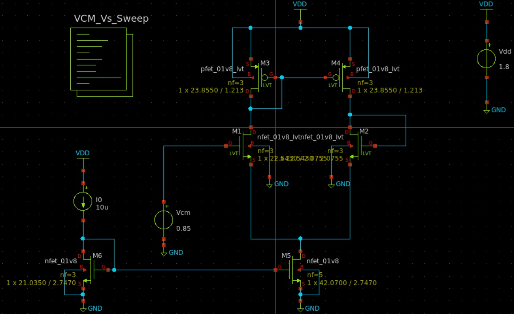
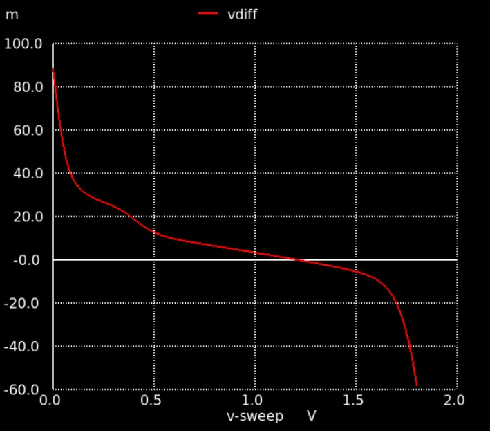

# Part 2: 5T OTA Sizing in SKY130 with ICMR and CMRR Constraints using Open-LUT

> A step-by-step guide extending the Open-LUT sizing methodology to meet Input Common-Mode Range (ICMR) and Common-Mode Rejection Ratio (CMRR) specifications for a 5T OTA in SkyWater 130nm PDK.

> [!NOTE]
> **Scope & Focus:** This guide demonstrates how to navigate and leverage Open-LUT to handle ICMR and CMRR constraints. While essential $g_m/I_D$ equations are included, primary focus is placed on tool execution and simulation verification in Ngspice and Xschem.

---

## 1. Design Specifications

This second part extends the 5T OTA design methodology introduced in Part 1 by incorporating strict Input Common-Mode Range ($ICMR$) and Common-Mode Rejection Ratio ($CMRR$) targets. **Table 1** summarizes the expanded specifications.

### Table 1: Design Specifications

| Specification Parameter | Symbol | Target Value |
| :--- | :---: | :---: |
| **PDK Technology** | - | SkyWater 130nm (SKY130) |
| **Supply Voltage** | $V_{DD}$ | $1.8\text{ V}$ |
| **Reference Current** | $I_{bias}$ | $10\,\mu\text{A}$ |
| **Tail Current** | $I_{SS}$ | $20\,\mu\text{A}$ |
| **Capacitive Load** | $C_L$ | $5\text{ pF}$ |
| **Open-Loop DC Gain** | $A_{V,DC}$ | $\ge 32\text{ dB}\ (39.81\text{ V/V})$ |
| **Gain-Bandwidth Product** | $GBW$ | $\ge 5\text{ MHz}$ |
| **Input Common-Mode Range** | $ICMR$ | $0.7\text{ V to } 1.6\text{ V}$ |
| **Common-Mode Rejection Ratio** | $CMRR$ | $\ge 70\text{ dB}\ (3162.28\text{ V/V})$ |

---

## 2. $V_{DS}$ Bias Allocation & ICMR Constraints

Initial $V_{DS}$ bias allocation across the transistor stack is dictated by the input common-mode range limits of an NMOS-input 5T OTA:

$$V_{iCM,\min} > V_{GS1,2} + V_{ov5}$$

$$V_{iCM,\max} < V_{DD} - \vert{}V_{GS3,4}\vert{} + V_{th1,2} \approx V_{DD} - \vert{}V_{GS3,4}\vert{} + V_{GS1,2} + V_{ov1,2}$$

* **Lower Bound Limit:** For $V_{iCM,\min} = 0.7\text{ V}$ and allocating $V_{ov5} \approx 100\text{ mV}$, $V_{GS1,2}$ must satisfy $V_{GS1,2} < 0.6\text{ V}$. To operate at low gate voltage while maintaining moderate inversion transconductance efficiency, an LVT NMOS device (`sky130_nfet_01v8_lvt`) is selected for $M_1/M_2$.
* **Upper Bound Limit:** Targeting $V_{GS1,2} \approx 0.5\text{ V}$ and $V_{ov1,2} \approx 50\text{ mV}$ for design allowance, achieving $V_{iCM,\max} = 1.6\text{ V}$ requires $\vert{}V_{GS3,4}\vert{}$ for mirror loads $M_3/M_4$ to satisfy:

$$\vert{}V_{GS3,4}\vert{} < 1.8 - 1.6 + 0.5 + 0.05 = 0.75\text{ V}$$

* **$V_{DS}$ Headroom Budget Allocation:**
  * Tail transistor $M_5$ is assigned $V_{DS5} = 0.3\text{ V}$ ($> V_{ov5}$) to ensure saturation.
  * Diode-connected loads $M_3/M_4$ require $V_{DS3,4} = \vert{}V_{GS3,4}\vert{}$. Selecting $V_{GS3,4} = 0.5\text{ V}$ ($< 0.75\text{ V}$) allocates $V_{DS3,4} = 0.5\text{ V}$.
  * The remaining headroom $V_{DD} - V_{DS5} - V_{DS3,4} = 1.8 - 0.3 - 0.5 = 1.0\text{ V}$ is assigned to $V_{DS1,2}$.

**Figure 1** illustrates the initial target $V_{DS}$ bias allocation across the device stack.

  
   

  Figure 1. Initial $V_{DS}$ bias allocation under ICMR constraints.

## 3. Sizing Differential Input Pair ($M_1/M_2$)

The required transconductance $g_{m1,2}$ is derived from the $GBW$ specification:

$$GBW = \frac{g_{m1,2}}{2\pi C_L} \implies g_{m1,2} > 2\pi (5\text{ MHz})(5\text{ pF}) = 0.157\text{ mS} \approx 0.16\text{ mS}$$

With branch current $I_{D1,2} = 10\,\mu\text{A}$, the transconductance efficiency requirement is $(g_m/I_D)_{1,2} \ge 16\text{ S/A}$. Expressing open-loop DC gain as $A_{V,DC} = \frac{g_{m1,2}}{g_{ds1,2} + g_{ds3,4}} \ge 39.81\text{ V/V}$ at $g_{m1,2} = 0.16\text{ mS}$ bounds total output conductance to $g_{ds1,2} + g_{ds3,4} \le 4.02\,\mu\text{S}$. Allocating equal loss yields $g_{ds1,2} < 2.0\,\mu\text{S}$ and $g_{ds3,4} < 2.0\,\mu\text{S}$.

To provide design margin, target $g_{m1,2} = 0.17\text{ mS}$ and $g_{ds1,2} = 1.5\,\mu\text{S}$ are selected.

> [!IMPORTANT]
> **CRITICAL OPEN-LUT WORKFLOW RULE:** Select your device and $V_{DS}$ bias, then click **`Update`** once to load the lookup tables for that setup. After this initial update, **always click the `Clear Form / Reset Plots` button before entering every new set of values!** Open-LUT preserves previous input fields and solution curves until explicitly reset. Entering new numbers into an uncleared form can lead to parameter conflicts or invalid extractions.

In Open-LUT, select `sky130_nfet_01v8_lvt` at $V_{ds} = 1.0\text{ V}$ and click **Update** once. Entering $g_m = 0.17\text{ mS}$, $I_D = 0.01\text{ mA}$, and $g_{ds} = 0.0015\text{ mS}$ yields initial continuous channel dimensions ($L = 2.0755\,\mu\text{m}$, $W = 22.5428\,\mu\text{m}$).

Finalized dimensions and extracted operating parameters for $M_1/M_2$ are listed in **Table 2** (snapping $W$ to the SKY130 layout grid).

### Table 2: Sizing and Biasing for $M_1/M_2$

| Parameter | $(g_m/I_D)_{1,2}$ | $L_{1,2}$ | $W_{1,2}$ | $g_{m1,2}$ | $g_{ds1,2}$ | $V_{ov1,2}$ | $V_{GS1,2}$ |
| :--- | :---: | :---: | :---: | :---: | :---: | :---: | :---: |
| **Value** | $17\text{ S/A}$ | $2.0755\,\mu\text{m}$ | $22.5430\,\mu\text{m}$ | $0.17\text{ mS}$ | $1.5\,\mu\text{S}$ | $0.0548\text{ V}$ | $0.5174\text{ V}$ |

## 4. Sizing Current Mirror Loads ($M_3/M_4$)

With $V_{GS1,2} = 0.5174\text{ V}$ from Table 2 and $V_{ov1,2} = 0.0548\text{ V}$, the upper-bound limit for $V_{GS3,4}$ is updated:

$$\vert{}V_{GS3,4}\vert{} < V_{DD} - V_{iCM,\max} + V_{GS1,2} + V_{ov1,2} = 1.8 - 1.6 + 0.5174 + 0.0548 = 0.7722\text{ V}$$

The allocated $V_{DS3,4} = V_{GS3,4} = 0.5\text{ V}$ remains fully valid. Devices $M_3/M_4$ also require $g_{ds3,4} \le 2.0\,\mu\text{S}$ (target $1.5\,\mu\text{S}$) to satisfy total open-loop gain requirements.

In Open-LUT, select `sky130_pfet_01v8_lvt` with $V_{ds} = 0.5\text{ V}$ and click **Update**. Inspecting the $V_{GS}$ vs $g_m/I_D$ curve (**Figure 2**) indicates that achieving $V_{GS3,4} \approx 0.5\text{ V}$ restricts $g_m/I_D$ to the range of $6.5\text{--}11\text{ S/A}$.

  
   

  Figure 2. $g_m/I_D$ vs $V_{GS}$ for `sky130_pfet_01v8_lvt` at $V_{ds} = 0.5\text{ V}$.

Click **`Clear Form / Reset Plots`**. For each trial iteration in Open-LUT, enter values in this exact sequence:
1. Enter $I_D = 0.01\text{ mA}\ (10\,\mu\text{A})$ first.
2. Enter a trial $g_m/I_D$ value selected from the $6.5\text{--}11\text{ S/A}$ range.
3. Enter target $g_{ds3,4} = 0.0015\text{ mS}\ (1.5\,\mu\text{S})$.

Repeat this input sequence across trial runs until $V_{GS3,4} = 0.5000\text{ V}$ is achieved. At $g_m/I_D = 10.5\text{ S/A}$, a gate bias of $V_{GS3,4} = 0.5077\text{ V} \approx 0.5\text{ V}$ is matched.

Snapping $W$ to the layout grid yields the finalized sizing and operating point summarized in **Table 3**.

### Table 3: Sizing and Biasing for $M_3/M_4$

| Parameter | $(g_m/I_D)_{3,4}$ | $L_{3,4}$ | $W_{3,4}$ | $g_{m3,4}$ | $g_{ds3,4}$ | $V_{ov3,4}$ | $V_{GS3,4}$ |
| :--- | :---: | :---: | :---: | :---: | :---: | :---: | :---: |
| **Value** | $10.5\text{ S/A}$ | $1.2130\,\mu\text{m}$ | $23.8550\,\mu\text{m}$ | $0.1050\text{ mS}$ | $1.5\,\mu\text{S}$ | $0.1519\text{ V}$ | $0.5077\text{ V}$ |

## 5. Sizing Tail Source ($M_5$) & Mirror ($M_6$) under CMRR Constraint

* **Lower-Bound Check:** With $V_{iCM,\min} = 0.7\text{ V}$ and $V_{GS1,2} = 0.5174\text{ V}$, overdrive voltage $V_{ov5}$ must satisfy:

$$V_{ov5} < V_{iCM,\min} - V_{GS1,2} = 0.7 - 0.5174 = 0.1826\text{ V}$$

The target $V_{ov5} \approx 100\text{ mV}$ falls well within this upper limit.

* **CMRR Constraint:** With $CMRR = \frac{A_{V,DC}}{A_{V,CM}} \ge 70\text{ dB}\ (3162.28\text{ V/V})$ and $A_{V,DC} = 39.81\text{ V/V}$, allowable common-mode gain is constrained to:

$$A_{V,CM} \le \frac{39.81}{3162.28} = 0.0126\text{ V/V}$$

Expressing common-mode gain for a 5T OTA as $A_{V,CM} \approx \frac{g_{m1,2}}{g_{m3,4} \left(1 + \frac{2g_{m1,2}}{g_{ds5}}\right)} \le 0.0126$ and solving for tail output conductance $g_{ds5}$:

$$g_{ds5} \le \frac{2 \cdot g_{m1,2}}{\frac{g_{m1,2}}{0.0126 \cdot g_{m3,4}} - 1} = \frac{2 (0.17\text{ mS})}{\frac{0.17\text{ mS}}{0.0126 (0.105\text{ mS})} - 1} = 2.67\,\mu\text{S}$$

In Open-LUT, select `sky130_nfet_01v8` at $V_{ds} = 0.3\text{ V}$ and click **Update**. Entering tail current $I_D = 0.02\text{ mA}$ ($I_{SS}$) and evaluating $g_{ds}$ across $g_m/I_D$ shows that $g_{ds} = 2.0\,\mu\text{S}$ is not achievable across all regions, but a minimum $g_{ds5} = 2.3\,\mu\text{S}$ is attained within the $g_m/I_D$ range of $14\text{--}17\text{ S/A}$. Since $2.3\,\mu\text{S} < 2.67\,\mu\text{S}$, this satisfies the CMRR specification with margin.

Iterating within $14\text{--}17\text{ S/A}$ to match target $V_{ov5} \approx 0.1\text{ V}$ yields $g_m/I_D = 16\text{ S/A}$. Grid-snapped dimensions and extracted parameters are summarized in **Table 4**.

### Table 4: Sizing and Biasing for $M_5$

| Parameter | $(g_m/I_D)_5$ | $L_5$ | $W_5$ | $g_{m5}$ | $g_{ds5}$ | $V_{ov5}$ | $V_{GS5}$ |
| :--- | :---: | :---: | :---: | :---: | :---: | :---: | :---: |
| **Value** | $16\text{ S/A}$ | $2.7470\,\mu\text{m}$ | $42.0700\,\mu\text{m}$ | $0.3200\text{ mS}$ | $2.3\,\mu\text{S}$ | $0.1034\text{ V}$ | $0.6508\text{ V}$ |

Bias mirror $M_6$ carries $I_{bias} = 10\,\mu\text{A}$ (half of $I_{SS}$) and is scaled proportionally to half the width of $M_5$: $(W/L)_6 = 21.0350 / 2.7470\,\mu\text{m}$.

## 6. Verification in Xschem & Ngspice

The design was verified using Xschem and Ngspice within the IIC-OSIC-TOOLS Docker environment (**Figure 3**; schematic files located in `./cir/` subfolder).

  
   

  Figure 3. Xschem simulation setup for Part 2 verification.

To select the valid common-mode bias window, a DC common-mode sweep (`.dc VCM 0 1.8V`) is performed, tracking $g_{m1,2}$ (**Figure 4**) and tail current $I_{SS}$ (**Figure 5**).

<table style="border-collapse: collapse; border: none; width: 100%;">
  <tr style="text-align: center;">
    <td style="padding: 0; width: 50%; text-align: center; vertical-align: middle; border: 5px solid transparent;">
      

        
         
      

      

       Figure 4. Transconductance $g_{m1,2}$ vs $V_{CM}$.
      

    </td>
    <td style="padding: 0; width: 50%; text-align: center; vertical-align: middle; border: 5px solid transparent;">
      

        
         
      

      

       Figure 5. Tail current $I_{SS}$ vs $V_{CM}$.
      

    </td>
  </tr>
</table>

The plots show that $V_{CM} > 0.675\text{ V}$ satisfies $g_{m1,2} \ge 0.17\text{ mS}$, while $V_{CM} < 0.90\text{ V}$ maintains $I_{SS} \le 20\,\mu\text{A}$. Evaluating DC operating points across $0.675\text{--}0.90\text{ V}$ identifies $V_{CM} = 0.85\text{ V}$ as the optimal bias point. **Table 5** compares Open-LUT predictions against Ngspice simulation results at $V_{CM} = 0.85\text{ V}$.

### Table 5: Open-LUT vs. Simulated Operating Point ($V_{CM} = 0.85\text{ V}$)

| Operating Parameter | Open-LUT Value | Simulated Value (Ngspice) |
| :--- | :---: | :---: |
| $g_{m1,2}$ | $0.1700\text{ mS}$ | $0.1776\text{ mS}$ |
| $g_{ds1,2}$ | $1.5000\,\mu\text{S}$ | $1.3710\,\mu\text{S}$ |
| $V_{ov1,2}$ | $0.0548\text{ V}$ | $0.0866\text{ V}$ |
| $V_{GS1,2}$ | $0.5174\text{ V}$ | $0.5597\text{ V}$ |
| $V_{DS1,2}$ | $1.0000\text{ V}$ | $0.9208\text{ V}$ |
| $I_{D1,2}$ | $10.000\,\mu\text{A}$ | $9.9681\,\mu\text{A}$ |
| $g_{m3,4}$ | $0.1050\text{ mS}$ | $0.1161\text{ mS}$ |
| $g_{ds3,4}$ | $1.5000\,\mu\text{S}$ | $1.4780\,\mu\text{S}$ |
| $V_{ov3,4}$ | $0.1519\text{ V}$ | $0.1415\text{ V}$ |
| $V_{GS3,4}$ | $0.5077\text{ V}$ | $0.5889\text{ V}$ |
| $V_{DS3,4}$ | $0.5000\text{ V}$ | $0.5889\text{ V}$ |
| $I_{D3,4}$ | $10.000\,\mu\text{A}$ | $9.9681\,\mu\text{A}$ |
| $g_{m5}$ | $0.3200\text{ mS}$ | $0.3271\text{ mS}$ |
| $g_{ds5}$ | $2.3000\,\mu\text{S}$ | $2.3550\,\mu\text{S}$ |
| $V_{ov5}$ | $0.1034\text{ V}$ | $0.1048\text{ V}$ |
| $V_{GS5}$ | $0.6508\text{ V}$ | $0.6377\text{ V}$ |
| $V_{DS5}$ | $0.3000\text{ V}$ | $0.2903\text{ V}$ |
| $I_{D5}$ | $20.000\,\mu\text{A}$ | $19.9361\,\mu\text{A}$ |

AC frequency response and CMRR curves are presented in **Figures 6 & 7**.

  
   

 Figure 6. AC magnitude response.

  
   

 Figure 7. Common-Mode Rejection Ratio ($CMRR$) vs frequency.

To verify $ICMR$, the OTA is configured as a unity-gain follower with $V_{in,-}$ connected to $V_{out}$ and $V_{in,+}$ swept across $V_{CM}$ (**Figure 8**). Measuring output tracking error ($< 10\text{ mV}$) confirms an operational range of $0.628\text{ V}$ to $1.653\text{ V}$ (**Figure 9**). **Table 6** confirms full compliance with all specifications.

  
   

 Figure 8. 5T OTA configured as unity-gain follower for ICMR testing.

  
   

 Figure 9. Output tracking error plot across $V_{CM}$ sweep.

### Table 6: Simulation Results vs. Specifications

| Specification Parameter | Target Requirement | Simulated Performance |
| :--- | :---: | :---: |
| **Open-Loop DC Gain ($A_{V,DC}$)** | $\ge 32.00\text{ dB}$ | $35.84\text{ dB}$ |
| **Gain-Bandwidth Product ($GBW$)** | $\ge 5.00\text{ MHz}$ | $5.56\text{ MHz}$ |
| **Tail Current ($I_{SS}$)** | $\le 20.00\,\mu\text{A}$ | $19.9361\,\mu\text{A}$ |
| **Common-Mode Rejection Ratio ($CMRR$)** | $\ge 70.00\text{ dB}$ | $77.27\text{ dB}$ |
| **Input Common-Mode Range ($ICMR$)** | $0.70\text{ V to } 1.60\text{ V}$ | $0.628\text{ V to } 1.653\text{ V}$ |

---

## 7. Conclusion

Building upon the single-pass framework established in Part 1, the elimination of time-consuming simulation-in-the-loop workflows still applies when incorporating strict $ICMR$ and $CMRR$ constraints. By translating system-level common-mode specifications directly into $V_{DS}$ headroom budgets and output conductance limits, deterministic, single-pass device sizing is fully maintained without relying on trial-and-error simulation loops. Complete schematic files for simulation and
